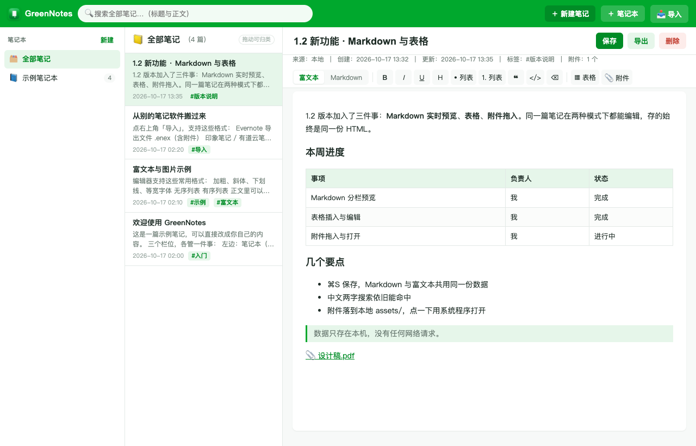
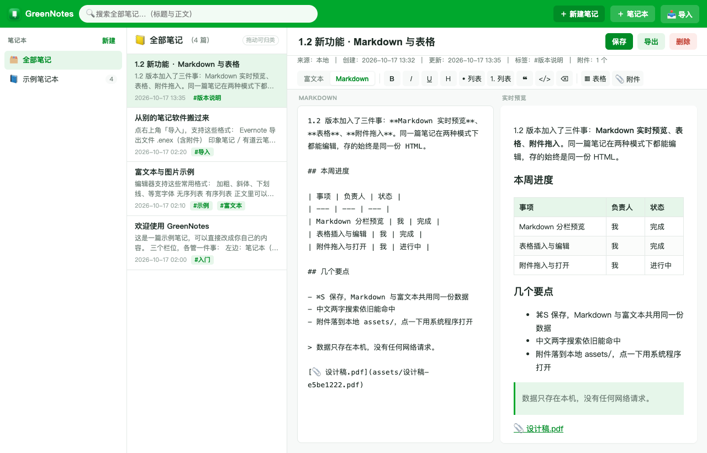
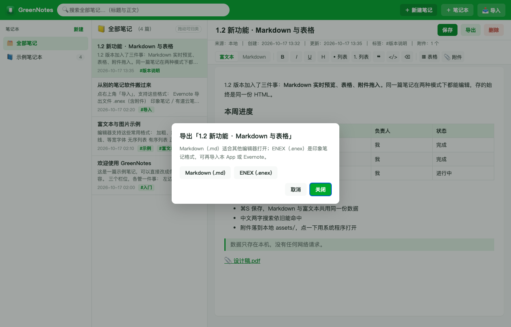
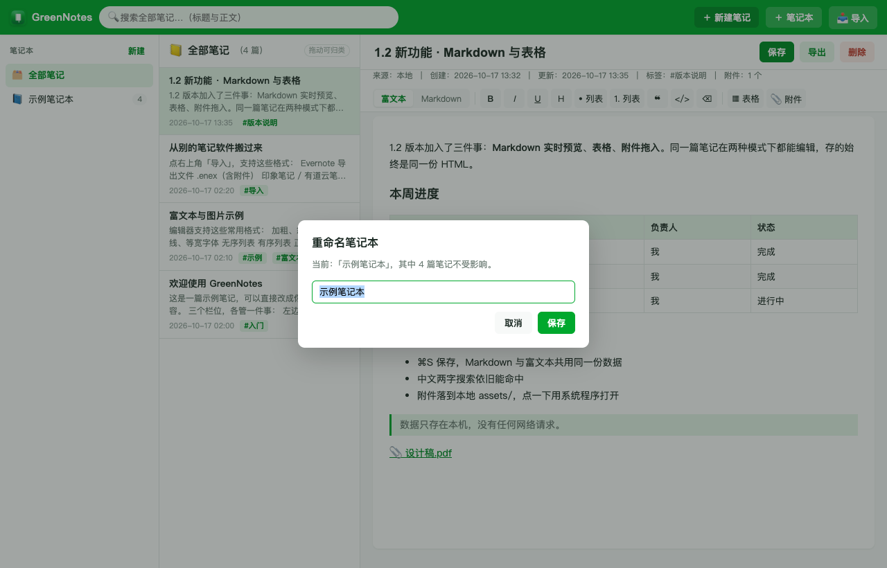
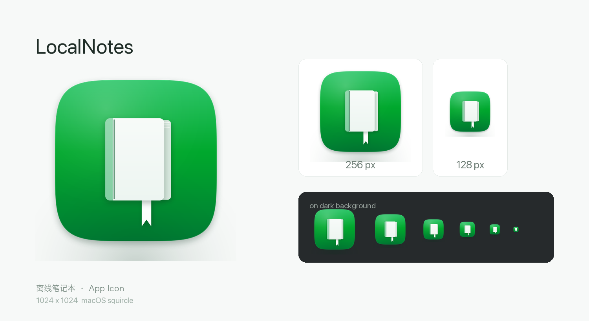

# GreenNotes · 离线笔记本

**一个完全本地运行的 Evernote 风格笔记本应用，macOS 原生窗口，双击即用。**

不上传、不同步、不登录、不联网。所有笔记存在你自己电脑上的一个 SQLite 文件里，
断网、关机、卸载重装都不会丢；把数据目录拷走就是完整迁移。

> **EN** · A local-first, Evernote-style note app for macOS — offline, no account, no sync.
> Full English README: **[README.en.md](README.en.md)**

<p>
  
  
  
  
  
</p>



*[English →](README.en.md)*

---

## 下载安装

**[⬇ 下载 GreenNotes-1.4.dmg](https://github.com/jarodHAN/GreenNotes/releases/latest)**（18 MB，内嵌运行环境）

也放在仓库里：[`dist/GreenNotes-1.4.dmg`](dist/GreenNotes-1.4.dmg)

1. 双击 dmg，把 `GreenNotes.app` 拖进 `Applications`
2. 第一次打开：在「应用程序」里 **右键点 GreenNotes → 打开 → 再点「打开」**
   （没有付费开发者证书，会被 Gatekeeper 拦一次，这是正常的，不是文件损坏）
3. 如果提示「已损坏，无法打开」，在终端执行一次再打开：

```bash
xattr -dr com.apple.quarantine /Applications/GreenNotes.app
```

**系统要求**：macOS 11 (Big Sur) 或更新。Intel 与 Apple Silicon 都能直接跑（通用二进制），
**目标电脑不需要安装 Python、不需要联网、不需要任何依赖**——包内自带裁剪过的 Python 3.13.16。

校验安装包：

```bash
shasum -a 256 GreenNotes-1.4.dmg
# d300d610f77d0734d2866341cee461cf4ded3f6f6ee02ed38ef1adaf5bc7f178
```

> **1.3 起应用改名为 `GreenNotes.app`**（1.2 及以前叫 `LocalNotes.app`）。升级时旧数据会自动从
> `~/Library/Application Support/LocalNotes/` 复制到 `…/GreenNotes/`，原目录保留作备份，不会丢笔记。

---

## 功能

| 分类 | 说明 |
|---|---|
| **笔记本** | 新建、删除；**双击名字直接改名**，或点悬停出现的铅笔 `✎`，或右键菜单 |
| **笔记** | 新建、编辑、保存（⌘S）、删除；标题与正文分离，列表按更新时间倒序 |
| **自动存档** | 默认 **每分钟自动保存一次**；切到别的 App / 最小化时也存一次，新笔记没按过保存也会自动建档 |
| **富文本** | 加粗 / 斜体 / 下划线 / 等宽 / 无序列表 / 有序列表 / 引用 / 代码 / 清除格式 |
| **Markdown** | 工具栏切到 **Markdown** 后是「源码 + 实时预览」左右分栏，改一个字预览立刻更新；两种模式共用同一份数据（存 HTML） |
| **表格** | 一键插入 2×2 ~ 5×4 表格，单元格里直接输入，Tab 跳下一格；导出 Markdown 时自动变成 GFM 表格 |
| **附件** | 把文件拖进正文即可（**不用先保存笔记**）：图片直接显示，PDF/Office/压缩包变成附件卡片；卡片上的 `✕` 或图片右上角的 `✕` 可单独删除 |
| **全文搜索** | 标题 + 正文一起搜，中文两字也能命中（FTS5 trigram，短词自动回退 LIKE） |
| **导入** | Evernote `.enex`（含图片附件）、印象笔记/有道云笔记导出的 HTML、Markdown、纯文本、Obsidian 笔记库、普通文件夹批量递归 |
| **导出** | 单篇或整本笔记本 → Markdown / ENEX；中文标题文件名不乱码；导出前自动保存 |
| **拖拽归类** | 按住笔记拖到左侧任意笔记本上即完成移动，目标会高亮 |
| **标签** | 导入时保留原标签，编辑器内显示 |

### Markdown 实时预览



工具栏左侧的 **富文本 / Markdown** 是同一篇笔记的两种编辑方式，随时切换、来回不丢东西：

- 切到 Markdown 时，当前正文由服务端 `html_to_markdown` 转成源码填进左侧
- 右侧预览是纯前端渲染（自带 GFM 子集：标题、列表、引用、代码块、表格、图片、删除线），逐字更新，不联网
- 保存（⌘S）或切回富文本时，源码经 `md_to_html` 转回 HTML 入库——**库里始终只有一份 HTML**，
  搜索、导出 ENEX、导入其他格式都不受影响

### 表格

点工具栏 **▦ 表格** 选尺寸即可插入。富文本模式下直接在格子里打字，Tab 跳到下一格；
Markdown 模式下插入的是 `| 列1 | 列2 |` 模板。表头、斑马纹、对齐（`:-` `:-:` `-:`）都支持，
导出的 Markdown 是标准 GFM 表格，ENEX 里则是原生 `<table>`。

### 附件拖入

把文件从 Finder 拖进正文任意位置即可：

| 类型 | 行为 |
|---|---|
| 图片（png / jpg / gif / webp…） | 直接插入正文并显示 |
| 其他文件（pdf / docx / xlsx / zip…） | 变成 `📎 文件名 + 体积` 的附件卡片 |
| 剪贴板里的截图 | 直接 ⌘V 粘贴，同样走上传 + 插入 |

附件落在数据目录的 `assets/` 里，同一篇笔记内相同内容只存一份（按 MD5 去重）。
点附件卡片不会把窗口导航走，而是交给系统用默认程序打开（WKWebView 里的原生 `NSWorkspace` 调用）。
单个文件上限 25 MB。

**不用先保存笔记**：即使是刚点「新建笔记」、还没存过的空白笔记，也可以直接把文件拖进去——
App 会在后台先把这篇笔记静默建好，再挂上附件，光标和正文都不会被打断。

**单独删除附件**：

| 对象 | 怎么删 |
|---|---|
| 附件卡片（PDF / Office / 压缩包…） | 卡片右侧的 `✕`，确认后从正文移除 |
| 正文里的图片 | 鼠标移到图片上，右上角出现 `✕`，点它确认删除 |

删除只会动这一处引用；**如果全库没有其它笔记再用这个文件，磁盘上的副本会一起清掉**，
否则文件会保留给还在用它的笔记。

### 自动存档

默认每 **1 分钟**自动保存一次，不需要手动 ⌘S（⌘S 依然可用）。
另外两种情况也会立刻存一次：

- 切到别的 App、最小化窗口、锁屏（`visibilitychange`）
- 关闭编辑器前处于「有改动」状态

只有内容真的变了才会写库（比较的是上一次保存时的编辑器快照），所以不会每分钟无意义地刷新「更新时间」。
自动保存成功后，编辑区上方那行元信息里会出现「已自动保存 HH:MM」。
新建但还没来得及保存的笔记也会被自动建档，不用怕忘了按保存就关掉。

### 导出



三个入口：编辑区右上角「导出」按钮、笔记本右键 →「导出笔记本…」、菜单栏 **文件 → 导出当前笔记…（⌘E）**。

Markdown 适合给别的编辑器打开，ENEX 是印象笔记/Evernote 的交换格式，可以再导回本 App 或 Evernote。

### 改名



双击、铅笔、右键三处都能进；弹窗预填原名并全选，Enter 保存 / Esc 取消。
后端会拦「空名字」和「同名笔记本」，不会把名字改成空串。

### 应用图标



---

## 数据与隐私

| | |
|---|---|
| 数据位置 | `~/Library/Application Support/GreenNotes/`（`notes.db` + `assets/`） |
| 网络 | **零外联**。App 只在本机 `127.0.0.1` 起一个随机端口的本地服务供窗口显示，不监听公网、不请求任何外部地址、无遥测 |
| 迁移 | 拷走上面整个文件夹，在新机器上放回同一位置即可 |
| 卸载 | 删 App 不删笔记；要彻底清空需手动删数据目录 |
| 备份 | 直接复制 `notes.db`（SQLite），或对单篇/整本导出 MD/ENEX |

> 注意：本项目**没有**做笔记内容加密，也不做云同步——这是设计选择，不是没做完。

---

## 从源码运行（开发态）

只需要系统自带的 Python 3（不需要 pip 装任何东西，纯标准库）：

```bash
git clone https://github.com/jarodHAN/GreenNotes.git
cd GreenNotes
python3 app/server.py          # 默认 http://127.0.0.1:8731
```

浏览器打开 `http://127.0.0.1:8731` 就是完整界面（这条路径也方便调试前端）。

可选环境变量：

```bash
GREENNOTES_DATA=/tmp/mynotes   # 换数据目录（不影响正式数据，调试必备）
GREENNOTES_PORT=8899           # 固定端口
```

首次启动如果库是空的，会用 `app/sample.enex` 播种 3 篇示例笔记（全部是中性演示内容）。

---

## 构建 macOS App 与 dmg

需要 **Xcode Command Line Tools**（`xcode-select --install`，自带 `swiftc`），不需要 Xcode 工程。

```bash
# 1) 生成 .app（通用二进制 + 内嵌运行时 + ad-hoc 签名 + 收尾自检）
bash desktop_app/build.sh

# 2) 打成可分发的 dmg（内含 Apps 快捷方式与安装说明）
bash desktop_app/make_dmg.sh

# 换版本号
VERSION=1.3 bash desktop_app/make_dmg.sh
```

`build.sh` 结束会做自检，七条任一不满足直接失败退出：内嵌运行时存在、`importers` 存在、
前端页面存在、签名有效、包内**不含**本地数据（`notes.db` / `assets`）、没有 `__pycache__` / `.pyc`、
没有嵌套的 `importers/importers` 副本。

### 内嵌 Python 运行时（可选，但 dmg 分发必须）

`build.sh` 会检查 `desktop_app/runtime/python/`，有就整体塞进 App（约 44 MB），
没有就跳过（这时打出的包要求目标机自带 `python3`）。这个目录不进仓库，需要自己生成一次：

```bash
# 下载同版本的 python-build-standalone（两个架构都要）
#   cpython-3.13.16+<date>-x86_64-apple-darwin-install_only_stripped.tar.gz
#   cpython-3.13.16+<date>-aarch64-apple-darwin-install_only_stripped.tar.gz
# 解包后得到两份 python/ 目录，然后：
python3 desktop_app/build_runtime.py /path/to/x86_64/python /path/to/arm64/python \
        desktop_app/runtime/python
```

它会以 arm64 树为骨架，用 `lipo -create` 把每个 Mach-O 合成胖二进制，
再裁掉 `test/`、`tkinter`、`idlelib`、`ensurepip`、Tcl/Tk 整套、`__pycache__`、无人引用的
`libpython3.13.dylib`，把 90 MB 压到 44 MB（双架构）。

图标重新生成需要 Pillow（`pip install pillow`）；没装会自动沿用仓库里的 `AppIcon.png`。
换个图标风格：`ICON_VARIANT=A bash desktop_app/build.sh`（A 折角笔记 / **B 硬壳笔记本** / C 卡片）。

---

## 目录结构

```
GreenNotes/
├── app/                     # 后端 + 前端（纯标准库，零依赖）
│   ├── server.py            # HTTP 服务、路由、SQLite、FTS5、附件上传、HTML⇄MD 转换
│   ├── exporter.py          # 导出 Markdown / ENEX（单篇 + 整本）
│   ├── sanitize.py          # HTML 白名单净化（防 XSS，含空元素处理）
│   ├── sample.enex          # 首启示例数据
│   ├── static/index.html    # 单文件前端（富文本 + Markdown 双模式，无框架无构建）
│   └── static/icon-*.png
├── importers/               # 多格式导入器
│   ├── dispatch.py          # 按扩展名/内容分派
│   ├── enex.py  html.py  markdown.py  txt.py  youdao.py
│   └── common.py            # 统一入库、附件落盘、标题/时间推导
├── desktop_app/             # macOS 打包工具链
│   ├── shell/main.swift     # WKWebView 外壳（启动本地服务、菜单、导出通道）
│   ├── Info.plist           # bundle 元数据（macOS 11+）
│   ├── build.sh             # 生成 .app
│   ├── make_dmg.sh          # 生成 dmg
│   ├── build_runtime.py     # 双架构运行时合并 + 裁剪
│   ├── make_icon.py  icon_lib.py  icon_variants.py  # 图标生成
│   └── AppIcon.png
├── dist/GreenNotes-1.3.dmg  # 可直接分发的安装包
└── docs/images/             # 截图
```

设计取舍与构建链细节见 [`docs/ARCHITECTURE.md`](docs/ARCHITECTURE.md)（[English](docs/ARCHITECTURE.en.md)）：
为什么不用 Electron/Tauri、FTS5 trigram 的取舍、外壳必须手接的五处原生口、以及两条会静默产出坏包的脚本坑。

---

## 本地 API 一览

App 的窗口其实是个 WKWebView，前后端通过本机 HTTP 通信。这些接口也可以直接调（比如写脚本批量导入）：

| 方法 | 路径 | 说明 |
|---|---|---|
| GET | `/api/state` | 概览（笔记本数、笔记数） |
| GET | `/api/notebooks` | 笔记本列表（含每本笔记数） |
| GET | `/api/notes` | 笔记列表（可带 `?notebook_id=`） |
| GET | `/api/note/<id>` | 单篇详情（正文 HTML + 标签 + 附件） |
| GET | `/api/search?q=` | 全文搜索 |
| GET | `/api/tags` | 标签及计数 |
| GET | `/api/note/<id>/export?fmt=md\|enex` | 导出单篇 |
| GET | `/api/notebook/<id>/export?fmt=md\|enex` | 导出整本 |
| POST | `/api/convert` | HTML ⇄ Markdown 互转 `{from:'html'\|'md', text}` |
| POST | `/api/note/<id>/attach` | 上传附件 `{filename, data(base64)}`，返回 `assets/…` 地址 |
| POST | `/api/note/<id>/detach` | 删除单个附件 `{url}`；没有其它笔记引用时连磁盘副本一起清理 |
| POST | `/api/note` | 新建笔记 `{notebook_id,title,content_html,tags}` |
| POST | `/api/notebook` | 新建笔记本 `{name}` |
| POST | `/api/note/<id>` | 保存笔记 |
| POST | `/api/note/<id>/move` | 移动笔记 `{notebook_id}` |
| POST | `/api/notebook/<id>` | 重命名笔记本 `{name}` |
| POST | `/api/import` | 上传文件导入（multipart） |
| POST | `/api/import_path` | 按本机路径导入（文件夹会递归） |
| DELETE | `/api/note/<id>` | 删除笔记 |
| DELETE | `/api/notebook/<id>[?force=1]` | 删除笔记本（非空需 `force`） |

---

## 已知限制

- **没有云同步**，一台机器一份数据。要跨设备就拷数据目录，或用导出功能手动搬。
- **首次打开需要右键「打开」**：ad-hoc 签名，没有 Apple 付费开发者证书，也没有公证（Notarization）。
  要消掉这一步只能买 $99/年的 Apple Developer Program，改签名 + 公证 + 重打包。
- **只支持 macOS**。后端是纯标准库 Python，理论上 Linux 能跑，但窗口外壳是 WKWebView/cocoa，未做。
- 富文本编辑器是 `contenteditable`；Markdown 是另一种编辑视图，**不支持**脚注、数学公式、Mermaid 等扩展语法。
- 表格支持插入、编辑、对齐与导出，但还不能拖拽调列宽、合并单元格（`colspan/rowspan` 导入后会保留）。
- 附件单个上限 25 MB；只支持拖入/粘贴，暂不支持从「文件」菜单选择。
- `.enex` 里的**加密笔记不支持**（`<en-crypt>` 不在 HTML 白名单里，导入后正文为空，标题与标签仍在）。
- 单窗口、单进程；搜索没有高级语法（`AND`/引号分组等）。

后续想做的：表格列宽拖拽与合并单元格、按标签筛选、笔记内图片缩放、Linux/Windows 外壳、增量备份。
